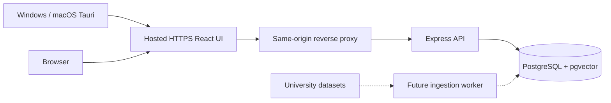

# Architecture and decisions

Status: development foundation, not a production deployment. One university per deployment; multi-tenant hosting is outside the current scope.

React/Vite provides one English UI for browser and desktop. A Tauri 2 shell targets Windows and macOS. Express provides the API. PostgreSQL 17 stores accounts, sessions, faculty profiles, publications and department export snapshots; pgvector prepares the same database for future semantic retrieval. A separate vector store is unnecessary until measured scale or retrieval requirements justify it.

## Access and identity

Roles are assigned by a trusted CLI, never by self-registration. Teachers manage only their own faculty profiles, publications and export snapshots. Student accounts cannot access faculty endpoints. The API derives ownership from the authenticated session; knowing an ID does not grant access. Legacy course endpoints retain their existing ownership/enrollment checks. Sessions use random tokens, hashed at rest, expire in eight hours and are deleted on logout. Passwords use salted scrypt. Mutations require the configured Origin. Cookies are HTTP-only, SameSite=Strict and Secure in production. The login rate limiter is per process; replace its store before horizontal scaling.

## Schema

`users -> sessions`; `users -> faculty_profiles`; `users -> publications`; `users -> department_exports`. See `FACULTY_DATA_MODEL.md` for the current shared schema and API. Legacy course/document tables remain intact.

Chunks reserve a provisional 1536-dimension embedding and model identifier. There is no embedding pipeline or semantic endpoint yet. Choose a model first and migrate the dimension if necessary. Never mix embedding models in an index. Keyword search remains available only in the legacy course API. The faculty workspace does not claim semantic search or automated publication matching.

## Real-data integration sequence

1. Inventory source owners, formats, identifiers, volumes, refresh cadence, classification and permitted uses. Keep raw data outside Git.
2. Measure missingness, duplicate keys, invalid references and inconsistent employee identifiers.
3. Agree on canonical identifiers and mappings using pseudonymized samples.
4. Add an idempotent staging importer with dry-run validation, rejected-row reports and lineage.
5. Establish document access rules before parsing or embedding. Approve any external model data processing with the university.
6. Parse, chunk and embed approved documents asynchronously, recording source and model versions.
7. Apply owner and purpose-specific authorization in SQL before retrieved text reaches a model. Treat retrieved content as untrusted data. Evaluate recall, citation accuracy, faithfulness, leakage, latency and cost.

## Deployment and desktop

Serve the web build and `/api` behind one HTTPS origin. Set APP_ORIGIN to that exact origin and NODE_ENV=production. The current API listens on loopback, suitable for a same-host proxy. Keep database credentials server-side. Set the desktop `build.frontendDist` to the deployed URL; the invalid placeholder prevents accidental distribution against an unrelated service. Test cookies in both platform webviews. No native commands or privileged plugins are included.

Windows requires Rust, Microsoft C++ build tools and WebView2. macOS requires a Mac and Xcode tools. Signed installers, notarization and updates remain deployment work.

Before production: SSO/OIDC, password recovery, account deactivation, enrollment removal, audit events, expired-session cleanup, shared login throttling, monitoring, least-privilege database roles, backup/restore checks and load tests. Consider row-level security as defense in depth. Grades and private student profiles are not implemented.

Sources: https://github.com/pgvector/pgvector and https://v2.tauri.app/start/prerequisites/
